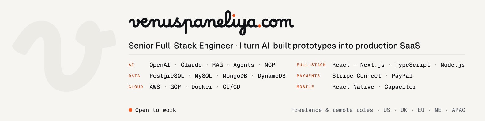

### Senior full-stack engineer. MERN, Next.js, TypeScript.

I build SaaS that holds up with real users: tenant isolation, payments that don't go missing, and AI features with a cost cap. 3+ years in production. I've led a team of 5 developers.

**[venuspaneliya.com](https://venuspaneliya.com)** · [LinkedIn](https://www.linkedin.com/in/venus-paneliya) · [venuspaneliya25@gmail.com](mailto:venuspaneliya25@gmail.com)

Open to full-time remote roles and long-term contracts.

---

### Shipped

| Project | Problem | What I did | Result |
| --- | --- | --- | --- |
| [Creator community platform](https://venuspaneliya.com/work/creator-community-platform/) | Dropped Stripe webhooks meant missed creator payouts | Moved payout state into an owned ledger with verified webhooks, retries and alerts | $10K+ paid out a month, 0 missed since launch |
| [AI form builder](https://venuspaneliya.com/work/ai-form-builder/) | Building forms field by field was slow, and AI output had to be valid every time | OpenAI prompt to strict JSON schema, validated on the server, with row-level security and token caps | One sentence to a working form in under 10s |
| [Video pipeline on AWS](https://venuspaneliya.com/work/video-pipeline-aws/) | Every video submission was handled by hand | Serverless S3, Lambda and SQS pipeline with retries and dead-letter queues | 60% less manual editing for 1,000+ users |
| [Insurance quote engine](https://venuspaneliya.com/work/insurance-quote-engine/) | Quotes took 10+ minutes and buyers dropped out | Redis caching, parallel insurer API calls, PostgreSQL index tuning | Under 2 minutes, cached under 30s |

Client code is private. Each case study shows the problem, the decision and the result. The source of my portfolio site is public: [venuspaneliya.com](https://github.com/VenusCodes/venuspaneliya.com).

### AI work

OpenAI and Claude APIs, RAG, agents and MCP, built on the same Node.js and MongoDB stack, with token caps so AI cost stays flat. Public examples are coming to this profile.

### Stack

**Frontend:** `JavaScript` `TypeScript` `React` `Next.js` `Redux Toolkit` `HTML5` `CSS3` `Tailwind CSS`

**Backend:** `Node.js` `Express` `REST APIs` `GraphQL` `Socket.io` `Webhooks` `Strapi` `Microservices` `OAuth / RBAC`

**Data:** `MySQL` `PostgreSQL` `MongoDB` `DynamoDB` `Supabase` `Redis` `Firebase`

**Cloud:** `AWS Lambda` `SQS` `S3` `EC2` `Google Cloud` `Docker` `GitHub Actions` `Vercel` `Netlify` `Heroku`

**Mobile:** `React Native` `Capacitor` `iOS` `Android` `Push notifications` `Maps and location`

**AI:** `OpenAI API` `Claude API` `RAG` `Agents` `MCP` `tiktoken` `Cursor`

**Payments:** `Stripe Connect` `PayPal` `Authorize.net`
